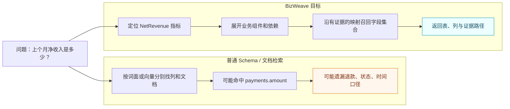
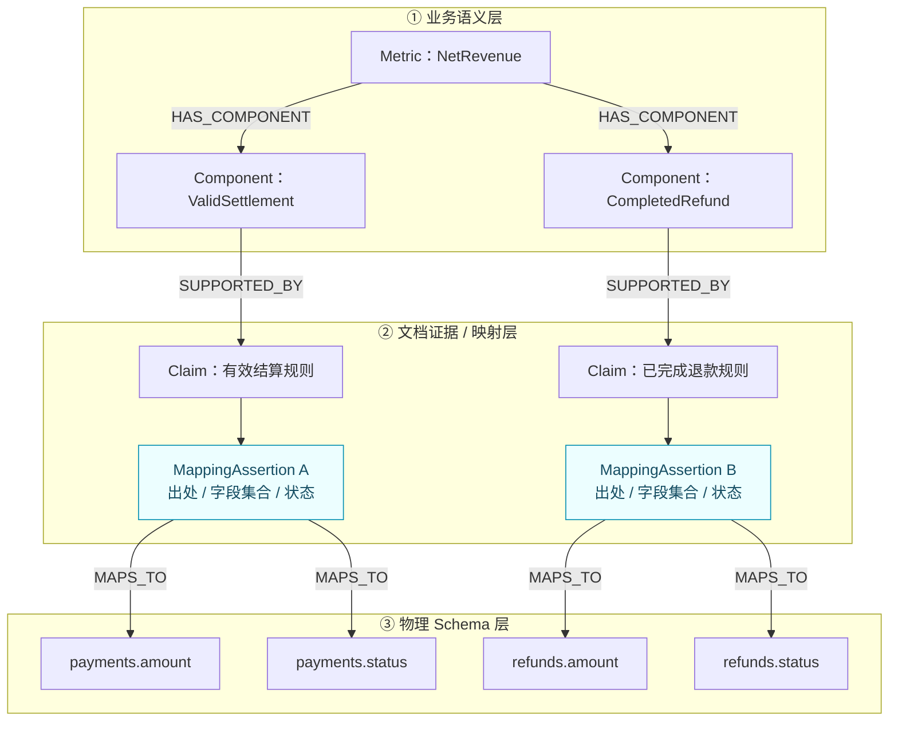
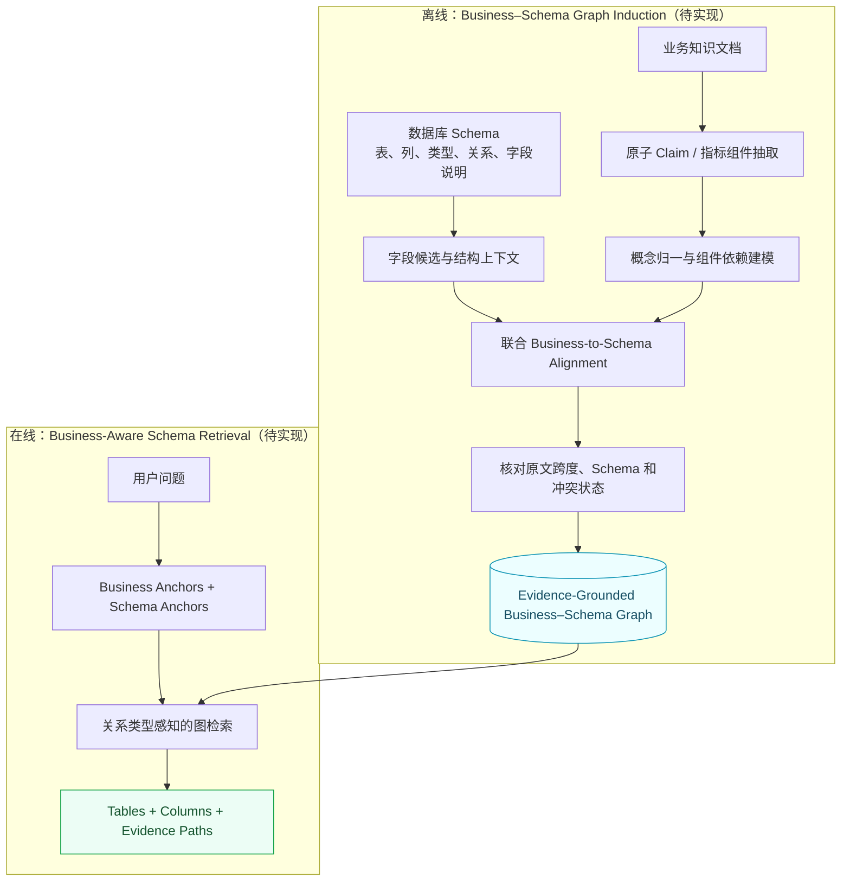
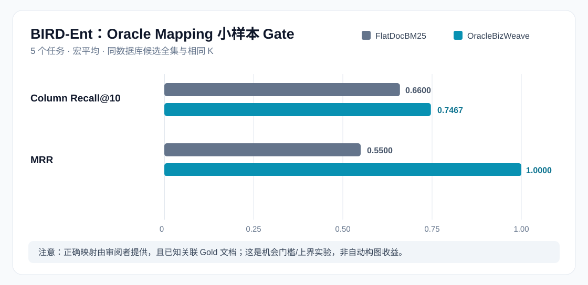
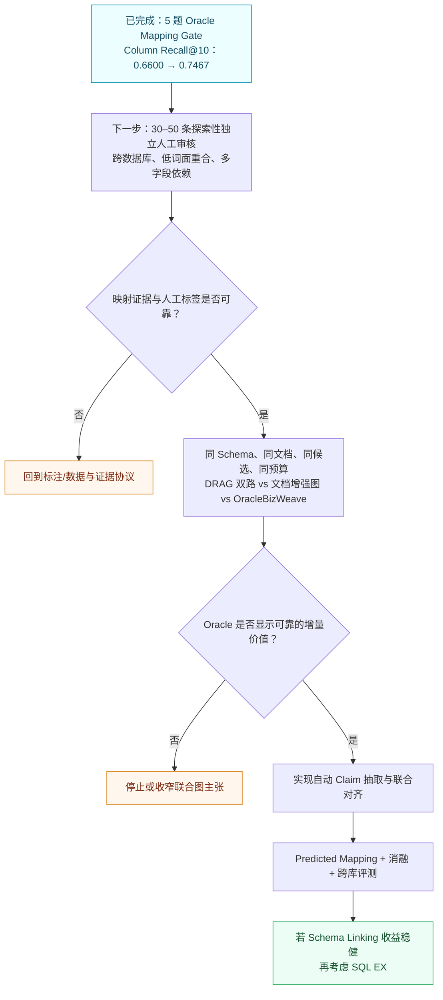

# BizWeave 研究汇报｜从业务文档构建有证据的 Business–Schema 图

> **汇报日期：2026-11-24** · **研究状态：探索性方案，已完成 BIRD-Ent Oracle Mapping 可行性 Gate**  
> **一句话目标：** 把分散在业务文档里的概念、事件、指标和规则，自动对齐到数据库的表和列，形成**有证据、可组合、可核验**的异构图，帮助 Text-to-SQL 更完整地找到必要 Schema。  
> **注意：** 本文以仓库 **11 月 23 日收敛后的最新主线**为准。此前“按事件约束选 JOIN 路径、冲突时弃答”属于历史探索，不是当前主贡献。

---

## 01｜研究背景：Schema 能连起来，不代表理解了业务

**Text-to-SQL 的前置难点**：用户说的是业务术语，物理数据库存放的是分散的字段。

以“统计上个月**净收入**”为例（**教学示意，不是某个数据集的真实 Schema**）：

- 业务文档可能定义：净收入 = **有效结算金额 − 已完成退款金额**；
- 物理字段可能位于 `payments.amount`、`payments.status`、`refunds.amount`、`refunds.status`；
- “有效”“已完成”的状态口径要从业务定义核实，不能凭相似度猜；
- 只检索与“收入”词面相近的列，可能漏掉退款金额和两个状态条件。

### 图 1：普通字段检索与业务映射的区别



**研究切入点**：传统 Schema Graph 主要表达 `Table–Column–Foreign Key` 结构；BizWeave 拟在其上补充**业务定义到物理字段的、带证据的跨层关系**。

> **汇报时可以这样讲：** 我们不是要再做一个普通表关联图，而是想知道“净收入”等业务概念究竟需要哪些字段，以及这种对应关系是否真的由业务文档支持。

---

## 02｜核心 Idea：Evidence-Grounded Business–Schema Graph

### 图 2：拟议的三层图（字段仅为示例）



### 图中真正重要的不是“多了几个节点”，而是 **MappingAssertion**

一条映射声明应当记录：

| 属性 | 作用 |
|---|---|
| Business Claim / Component | 说明这是哪个业务语义或指标组成部分 |
| Target Table / Column **集合** | 允许一个业务定义依赖多个字段，而非强制一对一 |
| Document ID + Span | 能回到支持该映射的原文位置 |
| Scope / Conditions | 状态口径、时间口径、适用范围等必要条件 |
| Verification State | 已支持、冲突、未决；无证据时不能自动补边 |

**拟议的关键机制：Joint Business-to-Schema Alignment（联合对齐）。**

独立匹配通常是“每个业务词选一个最相似列”；我们想研究的是：**一组互相依赖的业务 Claim / Metric Components，能否在语义、结构和证据共同约束下，联合映射到一组表列**。

一个可讨论的研究目标（**概念性公式，尚未实现为确定的优化算法**）：

```text
最优映射 = 语义匹配得分
         + 关系/组件完整性得分
         + 文档证据支持得分
         - 映射冲突惩罚
```

要成为论文方法，需要明确联合搜索/约束究竟如何改变候选选择，并在实验中证实优于单字段独立对齐。

---

## 03｜整体方法：离线构图，在线检索

### 图 3：当前拟议框架



**现阶段的边界：**重点验证 **Schema Linking / Retrieval**，而不是同时解决 SQL 生成、最终 JOIN 路径裁决或复杂弃答机制。图检索可以先复用简单方法；更重要的是证明**业务映射边本身是否有增量价值**。

---

## 04｜与已有工作的差异：我们的创新点在哪里？

| 已有路线 | 已有能力 | BizWeave 必须证明的新增价值 |
|---|---|---|
| **DANKE / KG-to-Text-to-SQL** | 已有业务知识图谱、概念到物理 Schema 映射及 Schema Linking | **不能**把“业务 KG 映射表列”单独当创新；需证明**自动、可核验证据、联合多字段对齐**的差异 |
| **DRAG / BIRD-Ent** | Schema Retriever 与 Knowledge Retriever 分开检索 | 将同一批业务文档**离线组织成可复用映射关系**是否比双路检索更完整 |
| **Graph-Link / GRASP-SQL** | Schema 图结构、子图选择与相关性排序 | 业务 Claim 与物理表列的**跨层证据关系**，不是仅改进 Steiner / PCST |
| **GeSI / EmSI** | 从表格数据推断概念 Schema | 从**外部业务文档**抽取规则与组件，并把它们绑定到可执行的字段集合 |

**两个候选贡献（待验证）：**

1. **Evidence-Grounded Business–Schema Graph Induction**：从文档与 Schema 自动生成可追溯的业务语义映射，并显式保留证据、冲突与未决。
2. **Joint Business-to-Schema Alignment for Retrieval**：针对一个指标需要多个字段、低词面重合或跨文档依赖的情况，联合选择必要表列并提高完整召回。

**学术风险：**直接先行工作 **DANKE** 已触及业务 KG 到 Schema 的映射；当前不能声称“首次”。要证明的不是“图有业务节点”，而是**联合对齐机制 + 同等信息下的实证增益**。

---

## 05｜目前做了什么实验？

### 5.1 早期探索：为什么从旧主线转向文档—Schema 映射？

| 时间 | 实验 | 观察 | 对当前 Idea 的意义 |
|---|---|---|---|
| 11/17 | 合成业务事件约束 | 手工结构化规则 **8/8** 已解决样例、**2/2** 正确弃答 | 仅证明表达机制；不是自动建图或真实数据效果 |
| 11/21 | BIRD 零外键 Schema 图 | Recall@5：**79.8% → 86.5%**，但 Recall@1：**44.9% → 37.0%** | 图可能改善宽松覆盖，但首位排序变差；没有业务文档 |
| 11/22 | Spider `bike_1` Schema 图 | Recall@3：**99.04% → 99.52%**，Recall@1：**71.63% → 39.42%** | 小库高 K 指标接近饱和；依然没有业务语义层 |
| **11/24** | **BIRD-Ent Oracle Mapping Gate** | 文档到字段的真实证据审阅 + 理想映射检索上界 | **第一次直接触及当前主线的 Claim→Column 证据映射假设** |

这些历史实验**不能相加**形成一条连续提升曲线：任务、数据、基线和研究命题并不相同。

### 5.2 最新结果：BIRD-Ent Oracle Mapping Gate（2026-11-24）

**数据**：公开 BIRD-Ent 固定版本，选取 **5 个不同 data asset 的任务、9 份关联文档**；同一数据库内候选规模为 **3–8 张表、12–124 列**。

**证据审阅**：审阅 **30 条 MappingAssertion**，其中 **23 条直接支持、7 条冲突/拟议/未决**，得到 **26 条 Claim→Column 映射边**。SQL 派生的 **15 个唯一 Gold 列**均被解析并映射成功。

**比较设置：**

- `FlatDocBM25`：问题与**已知关联的 Gold 文档**文本拼接后检索列；
- `OracleBizWeave`：由审阅者提供正确的 Claim→Column 关系，问题先匹配 Claim，再将得分传播到对应列，剩余列由 Schema BM25 补足；
- 两组使用相同数据库列候选全集和 K，但 **OracleBizWeave 获得了正确结构化映射的额外优势**，这是上界比较，不是自动构图的公平端到端比较。

### 图 4：最新实验结果



| 指标（5 题宏平均） | FlatDocBM25 | OracleBizWeave | 变化 |
|---|---:|---:|---:|
| **Column Recall@10** | 0.6600 | **0.7467** | **+0.0867（+8.67 个百分点）** |
| MRR（首个 Gold 列） | 0.5500 | **1.0000** | +0.4500 |
| Table Recall@5 | 1.0000 | 1.0000 | 无变化（已饱和） |

**逐题方向：**Oracle 提升 **2/5**、持平 **2/5**、下降 **1/5**；恰好达到预注册的“继续研究”门槛。只有 5 题，没有统计显著性结论。

**这轮到底证明了什么？**

> **已支持：** BIRD-Ent 的文档包含可引用到物理列的业务 Claim；在正确映射的 Oracle 条件下，有机会改变列排序、提高 Recall@10。  
> **尚未证明：** 自动抽取/构图是否成功、是否超越强双路检索、能否跨库泛化，以及 SQL 执行准确率是否提升。

**重要限制：** 映射由 AI 助手审阅，**不是独立人类金标**；两组都拿到 Gold 关联文档，未测试文档检索；BIRD-Ent 文档含数据集生成成分，不应外推到真实企业内部文档。

---

## 06｜为什么当前优先 BIRD-Ent，而不是 Spider？

**当前 Idea 的核心输入是“Schema + 业务文档”。**

- **BIRD-Ent**：公开的 Schema、企业风格知识文档和表/知识检索标签，更适合验证 Claim→Column 映射及与 DRAG 式双路检索对比。
- **Spider 1.0**：适合普通 Schema Linking / JOIN 对照，但缺少当前主线需要的外部业务知识任务；此前 `bike_1` 已说明小 Schema 容易指标饱和。
- **Spider 2.0-Lite**：存在明确事件编码和指标文档，适合作**后续跨场景验证或业务案例**，但本轮聚焦 BIRD-Ent 以减少变量。
- **BIRD（原始版）**：可以辅助筛选时间、粒度条件，但没有现成的 Claim→Column 人工映射金标。

BIRD-Ent 数据概况：**1,534 道问题、7 个 data asset 域、1,412 份知识文档（约 150 万 tokens）**；这些是数据集规模，不是本轮实际评分规模。

---

## 07｜下一步如何证明是一个“方法”，而不只是把文本变成图？

### 图 5：Go / No-Go 实验路线



### 必须做的公平对照与消融

| 模块 | 必要实验 | 回答的问题 |
|---|---|---|
| 双路文档检索 | **DRAG 式 Schema + Document Retriever** | 业务图是否真的优于“分开检索相同文档”？ |
| 文本增强图 | **Document-enriched Schema Graph** | 增益来自“结构化关系”还是“更多文本”？ |
| 自动化 vs 理想映射 | **Oracle Mapping vs Predicted Mapping** | 理想上界能否由自动构图接近？ |
| 映射机制 | **Independent vs Joint Alignment** | 多组件联合映射是否真正强于独立 Top-1 列匹配？ |
| 证据质量 | **去掉证据验证、打乱 Mapping 边** | 图是否利用了正确的关系与来源，而非碰巧靠词面相关？ |

**主指标**：Table / Column Recall@K、完整必要字段召回、MRR / Recall@1、Mapping Precision / Recall、证据支持准确率及检索成本。  
**重点切片**：低词面重合、跨字段依赖、多文档定义、近似但错误的字段。

**必须遵守：** 测试题的 Gold SQL、Gold Table/Column/Knowledge ID **不参与离线构图**；只在映射冻结后用于事后评价。Oracle 设置要单独报告，不能混成自动系统指标。

---

## 08｜现阶段结论：能否作为论文 Idea？

### 我们目前可以说

1. **问题有价值**：业务概念与物理表列之间存在语义断层，普通表图和文本检索未必能完整表达指标依赖。
2. **方向已收敛**：主要研究离线**有证据的 Business–Schema 联合映射**，在线 Schema Retrieval 验证其价值。
3. **已经有第一轮直接相关的可行性证据**：5 题 BIRD-Ent Oracle Gate 通过继续研究门槛。
4. **创新性仍待验证**：特别需要与 DANKE 的图映射能力、DRAG 的同文档双路检索以及独立字段匹配做严格比较。

### 我们目前不能说

- “已经实现自动业务文档到 Schema 的完整构图系统”；
- “BizWeave 在真实 Text-to-SQL 数据上稳定提升 8.67 个百分点”；
- “图检索或业务知识图谱本身是首次提出”；
- “已经提升最终 SQL Execution Accuracy”。

### 建议用来收尾的一句话

> **我们的下一步不是再生成一张更复杂的图，而是验证：把分散业务定义联合映射成带证据的字段关系，能否在相同文档、相同候选与相同预算下，比传统双路检索更可靠地找全 Text-to-SQL 所需的字段。**

---

## 09｜建议的 6–8 分钟口头汇报节奏

| 顺序 | 建议时长 | 要讲清的关键句 |
|---|---:|---|
| 背景与业务例子 | 1 分钟 | “表能 JOIN，不意味着理解净收入这类业务定义。” |
| 核心方法图 | 2 分钟 | “离线把 Claim、证据和字段集合联合映射，在线检索必要表列。” |
| 创新性与先行工作 | 1 分钟 | “DANKE 已做过业务 KG；我们必须证明自动证据对齐和联合映射的不同。” |
| 实验结果 | 1.5 分钟 | “Oracle 5 题 Recall@10 从 0.6600 到 0.7467，属于上界机会信号。” |
| 下一步与收尾 | 1–2 分钟 | “先 30–50 条独立标注和同信息强基线，再决定是否做自动建图。” |

---

## 资料与可追溯链接

**项目内部（当前分支）：**

- [最新 BizWeave Idea 定义](../ideas/bizweave.md)
- [11/23 讨论纪要与技术路线](../ideas/bizweave_discussion_minutes_20261123.md)
- [Idea 评审与已有工作对照](../ideas/bizweave_review_20261123.md)
- [11/24 BIRD-Ent Oracle Mapping 实验报告](../reports/bizweave_birdent_oracle_mapping_gate_20261124_001/README.md)
- [旧合成实验报告（历史背景）](../reports/bizweave_business_semantic_pilot_20261117_001/README.md)
- [Spider 2.0-Lite 旧数据筛查计划](../ideas/bizweave_spider2_data_plan_20261121.md)

**相关论文及数据来源：**

- [DANKE / KG-based Text-to-SQL（2026）](https://doi.org/10.1016/j.datak.2026.102580)
- [BIRD-Ent / DRAG，Findings EMNLP 2026](https://aclanthology.org/2026.findings-emnlp.1971/)
- [BIRD-Ent 数据集](https://huggingface.co/datasets/jjjycaptain/BIRD-Spider-Ent)
- [Graph-Link，ICML 2026](https://proceedings.mlr.press/v306/zhong26s.html)
- [GeSI / EmSI，arXiv](https://arxiv.org/abs/2605.23105)

---

*文档定位：组会研究汇报。方法图是设计示意，示例字段并非真实 Gold Schema；实验数值来自项目公开报告。所有未实现模块均按拟议方法呈现。*
