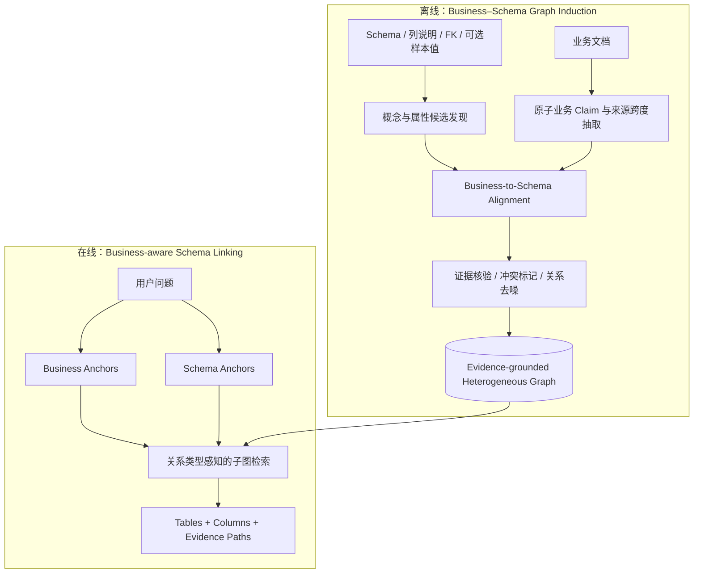

BizWeave：相关论文梳理与研究 Idea（讨论纪要）
整理日期：2026-11-23
研究阶段：探索 / 问题定义与实验设计
定位：从数据库 Schema 与业务文档自动构建有证据支撑的 Business–Schema 异构图，供后续 Schema Linking / Schema Retrieval 使用。
注意：本文整理此前讨论，不是对相关论文的重新完整复现；论文中已有的方法、BizWeave 的拟议设计以及尚待验证的假设分别标注。实验指标及具体实现细节在正式写作前应回原文和代码核验。

1. 最终聚焦的研究问题
1.1 我们究竟想做什么？
给定 数据库表、列、键/连接关系、字段说明 和 业务文档，离线自动构建一张能将业务语义与物理 Schema 联系起来的异构图；用户提问时，在线使用该图召回真正相关的表和列，并给出相应的业务证据路径。

不把 SQL 生成、最终 JOIN 路径判定、安全弃答或完整业务本体构建作为当前阶段的主贡献；它们可作为后续验证或扩展。
核心假设：相较于分别检索 Schema 和文档，显式建模带来源的“业务概念—业务关系—物理表列”映射，可以在低词面重合、跨字段依赖、复杂领域术语和冗余大 Schema 场景下，提高 Schema Linking 的完整召回与准确性。

1.2 与普通 Schema Graph 的本质区别
- 普通 Schema Graph：Table、Column、FK、候选 Joinable 关系；主要表达物理结构与可连接性。
- Enriched Schema Graph：在物理节点上添加语义描述、元数据或向量；改善语义匹配，但不一定将业务规则显式结构化。
- BizWeave（拟议）：将 Metric、Business Event、Business Concept、Business Rule、Metric Component 等作为可检索、可组合的节点或关系，并把它们通过带证据的映射绑定到 Table/Column；图结构旨在改变后续检索结果，而非仅存储文档。
例如“成功支付用户数”不只需要找到 users、`payments`，还可能依赖 payments.status、`payments.paid_at`、`payments.user_id`。何种状态码代表成功、以哪个时间字段统计、是否去重，都应由文档或其他合法证据支持，不能凭模型猜测。
2. 四项核心相关工作
2.1 GeSI / EmSI：Conceptual Schema Inference
- 论文：Conceptual Schema Inference for Tabular Datasets Using Large Language Models（此前讨论的 arXiv 版本）
- 研究问题：在缺少完整概念模型的表格数据集合上，从表头、列及样本值推断概念类型、属性、层级及实体间关系。
- 与我们最相关的核心机制：
  - GeSI：使用生成式 LLM 分阶段推断概念类型及层级、属性归并、实体关系和基数，最后整合为全局概念 Schema。
  - EmSI：利用语义嵌入、属性模式和聚类来组织概念及关系，更强调通过相似性发现结构。
- 可借鉴：局部概念发现 → 同义概念/属性归并 → 关系推断 → 全局图合并的建图流程；用表列及样本值发现业务概念的候选锚点。
- 与 BizWeave 的关键差异：这类工作重在恢复概念结构，并不以“从外部业务文档抽取具体业务规则，再绑定到可检索的物理列/条件”为主要研究目标。`Payment` 是一个概念，不等于已证明“成功付款”映射到哪个状态码及时间口径。
- 需警惕：高列语义相似度、共享取值或共享属性模式，不必然代表业务关系真实成立。
借鉴定位：BizWeave 离线概念发现与局部图归并的技术参考，而非直接照搬完整本体层级。
2.2 Graph-Link：受结构约束的 Schema Linking
- 论文：Graph-Link: Bridging the Semantic-Structural Gap in Text-to-SQL via Constrained Subgraph Induction（ICML 2026）
- 研究问题：纯文本检索可能找到用户明确提及的表，却漏掉低词面相似度但必需的中间连接表。
- 与我们最相关的核心机制：
  1. 构建分层 / 表中心 Schema 图，融合表、列和结构关联。
  2. 根据查询定位语义相关的锚点（Anchor）。
  3. 以 Steiner Tree / 近似子图优化连接锚点，补齐必要的桥接表。
  4. 对检索子图进一步精简。
- 可借鉴：不应对每个表/列独立 Top-K 排序；Schema Linking 是相关性 + 全局结构一致性的集合选择问题。
- 与 BizWeave 的关键差异：Graph-Link 主要围绕物理 Schema 的相关性、连接性与子图选择；BizWeave 希望新增由业务文档支持的 Metric → Component → Column、`Event → State/Time → Column` 等跨层关系。
- 需警惕：结构上能连通，不表示选到的字段满足业务语义；低成本路径也不一定是业务正确的实现。BizWeave 不必把 JOIN 路径选择扩展为当前唯一目标。
借鉴定位：BizWeave 在线图检索和联合子图选择的主要算法参考及结构基线。
2.3 GRASP-SQL：异构 Schema 图、图评分与召回优先检索
- 论文：GRASP-SQL（SSRN 预印本）
- 代码：GRASP-SQL GitHub
- 研究问题：在大 Schema 中平衡完整召回与检索噪声，防止遗漏关键桥接节点。
- 与我们最相关的核心机制（按论文框架）：
  1. Enriched Graph Construction：构建具有表、列与领域元数据的异构 Schema 图。
  2. Query-Conditioned Node Scoring：结合查询表示与 HGAT 等图表示机制计算节点相关性。
  3. Subgraph Extraction：利用 MST / PCST 等思想选择节点收益与边代价兼顾的候选子图。
  4. Bidirectional Filter：通过前后向检查精简冗余的表和列。
- 可借鉴：类型化图节点及关系、Query-aware 图评分、Recall-first 扩展后剪枝；可作为下游可替换 Retriever。
- 与 BizWeave 的关键差异：把领域描述加到 Schema 节点，并不等同于显式恢复业务概念、规则组成关系及其到物理字段的可验证映射。BizWeave 应主要创新于这张图如何建成且为什么有用，而非简单复用 HGAT/PCST。
- 实现核查提示：论文框架和公开仓库实际支持的模块可能不完全一致；正式复现前需分别核对方法说明、代码和训练产物，不能默认完整 HGAT 训练流程已公开。
借鉴定位：BizWeave 检索架构与对比对象，尤其用来检验“业务关系显式化”是否优于普通元数据增强图。
2.4 BIRD-Ent / DRAG：企业 Schema 与业务知识双路检索
- 论文：Text-to-SQL Benchmarks Toward Enterprise Realities: Under Massive Scopes, Complex Schemas and Scattered Knowledge（EMNLP 2026 Findings）
- 数据：BIRD-Spider-Ent / Hugging Face
- 研究问题：企业 Text-to-SQL 中不仅要从大量相似表/列中找到 Schema，还要从分散的业务文档中找到正确知识。
- 与我们最相关的核心机制：
  - DRAG = Schema Retriever 和 Knowledge Retriever 两路检索，之后把命中的表和文档送入 SQL Generator。
  - 提供大候选 Schema、企业风格名称、外部文档，以及表/知识文档等评估标注（具体字段和发布版本需以数据仓库为准）。
  - 原论文重点是检索困难与端到端评测，并非将业务规则预先组织成显式的 Business–Schema 联合图。
- 可借鉴：双路检索是必须击败的强基线；评估需要同时观察 Table Recall / Full Recall 与 Knowledge Recall，不能只看普通节点匹配准确率。
- 与 BizWeave 的关键差异：DRAG 将 Schema 与业务文档分别在线检索；BizWeave 尝试在离线阶段建立可复用、带证据的跨层映射，使查询能从业务概念沿关系找到物理表列。
- 限制：BIRD-Ent 的表与知识文档包含受控扩展/合成成分，没有直接提供我们期望的完整 Business Concept ↔ Physical Column 金标，也不保证包含大量真实业务语义歧义；应单独人工审核。
借鉴定位：BizWeave 首选数据候选与强双路检索基线。
3. 四篇论文的关系与研究空白
维度	GeSI / EmSI	Graph-Link	GRASP-SQL	BIRD-Ent / DRAG	BizWeave（拟议）
主要任务	概念 Schema 归纳	连通子图 Schema Linking	异构 Schema 图检索及剪枝	Schema / 文档双路检索与评测	业务知识驱动的 Schema 图构建与检索
自动发现概念	主要贡献	非重点	非主要贡献	非重点	是，需与字段映射联动
使用业务文档	非主要输入	非重点	领域元数据增强	是，独立检索	是，离线知识抽取 + 映射
显式业务规则到列的绑定	非主要目标	非主要目标	非主要目标	非主要目标	目标贡献（未实现）
结构连通子图检索	非主要目标	主要贡献	主要贡献之一	不是主方法	借鉴、扩展或复用
与 BizWeave 的关系	建图思想	结构检索基线	丰富图与图检索基线	数据和双路检索基线	待研究方法

不能据此认定无人做过类似工作。 这里仅总结本轮讨论的四项直接相邻工作；正式声称新颖性前，仍需扩展检索业务本体归纳、文档-模式对齐、知识图谱 Schema Linking、历史 SQL 规则挖掘等方向，逐篇核查技术重合。
4. BizWeave 的拟议技术路线
4.1 总体架构：离线建图、在线检索

图只是中间表示；最终以找到正确表列的能力检验其价值，不以业务节点数量或 JSON 结构合法性作为主要结果。
4.2 图节点与边：先做最小必要集合
层级	节点候选	关系候选
业务语义层	BusinessConcept、`Event`、`Metric`、`Rule`、`MetricComponent`	IS_A、`HAS_STATE`、`HAS_TIME_BASIS`、`HAS_COMPONENT`、`REQUIRES`
证据与映射层	DocumentSpan、`Claim`、`MappingAssertion`	SUPPORTED_BY、`DERIVED_FROM`、`MAPS_TO`、`CONFLICTS_WITH`
物理 Schema 层	Table、`Column`（可选 JoinRelation）	HAS_COLUMN、`FOREIGN_KEY`、`CANDIDATE_JOIN`

并非所有关系都应被强制生成。没有证据的映射保留 unknown/unresolved，不能为了图完整度凭空补充。

关键设计：把 MappingAssertion 作为一个可追踪对象，而非一条没有来源的裸边。它至少记录 source_id/span、证据类型、候选表列、验证情况，以及必要的作用域或歧义说明。
4.3 离线算法模块 A：Business Knowledge Induction
从文档中抽取原子 Claim，而非让 LLM 一次输出整张大图。
- 识别业务概念、别名、事件、指标与计算依赖。
- 提取状态枚举、时间口径、统计粒度等确实被证据支持的约束。
- 对概念去重与同义归并，保留来源跨度；冲突定义分开记录。
- 使用 Schema 名称、类型、字段说明及可选数据画像产生物理候选，不以测试 SQL 当作构图输入。
GeSI / EmSI 的分阶段归纳思想可用于概念初始化；但业务文档中的规则应独立抽取与核验。
4.4 离线算法模块 B：Joint Business-to-Schema Alignment（重点研究）
关键问题：业务文档不直接出现物理列名时，如何把一个业务概念及其依赖联合映射到多个字段？

例如文档定义：
净收入 = 有效结算金额 − 已完成退款金额。

那么不应只为“净收入”找最相似的一个金额字段，而应该同时约束：
- “有效结算金额”对应哪个金额列及可能的状态列？
- “已完成退款”对应哪个退款金额列及状态枚举？
- 两个概念需要怎样在表、字段和业务关系上保持一致？
可从基础方案逐步发展：
1. 独立匹配基线：Embedding / BM25 / LLM 一对一业务概念到列映射。
2. 局部结构对齐：引入表所属关系、类型、相邻列与业务 Claim 的上下文。
3. 联合关系对齐（研究候选）：让一组相关概念/规则与一组表列映射共同优化；使用关系兼容性、公式组件完整性与来源支持作为约束。
一个待研究的抽象目标（不是已有验证算法）是：
\[
M^*=\arg\max_M\big[S_{\mathrm{semantic}}(M)+\lambda S_{\mathrm{relational}}(M)+\mu S_{\mathrm{evidence}}(M)-\nu S_{\mathrm{conflict}}(M)\big].
\]
需要通过实际标签与消融验证“联合”是否比独立列打分有收益，避免只换一种加权评分但缺乏新机制。
4.5 离线算法模块 C：Evidence Verification & Graph Denoising
按边类型采用不同核验依据：
- Table HAS_COLUMN Column：以数据库元数据作确定性核验。
- Concept DEFINED_BY Claim：核对文档原始跨度与语义蕴含。
- Claim MAPS_TO Column：核对字段说明、类型和可选数据分布，记录可支持与不可判定部分。
- Table CANDIDATE_JOIN Table：区分声明 FK、类型/取值提示和推断关系；可连接不等于业务正确。
历史 SQL 若日后加入，只能视为“曾被使用”的证据，不能自动当作业务口径真值。
4.6 在线：Business-Aware Graph Retrieval
在线首先从查询定位两类锚点：
- Business Anchors：Metric、Event、Concept、Rule；
- Schema Anchors：Table、Column 的直接语义匹配。
再根据问题触发不同关系类型，选择有证据支撑且较紧凑的子图。例如指标查询优先 HAS_COMPONENT/MAPS_TO，事件查询优先 HAS_STATE/HAS_TIME_BASIS/MAPS_TO。

输出：`Tables + Columns + Evidence Paths`；路径示例：

Question → Net Revenue → Metric Component → Document Claim → Mapping Assertion → payments.amount。

可先用现成 Retriever、最短/Steiner 路径或 PCST 做简单版本，后续再考虑 Graph Neural Network；先证明图关系有用，后优化复杂检索器。
5. 与现有 BizWeave Pilot 的衔接
此前实验已显示：
- BIRD 零 FK 图：结构绑定有效，部分 Top-K Recall 提升，但 Recall@1 和 MRR 下降；生成图几乎未恢复事件、状态、时间、粒度。
- Spider 低 FK 图：图结构有效，但四表小库 Recall@3 已接近天花板，首位排序反而下降。
- 在线需求见证 Smoke：结构化输出未通过基本有效性门槛；这首先是抽取/输出协议问题，不能据此否定图建模价值。
- 合成约束试验：只能证明手工规则在设计案例中可区分含义，不证明真实文档中的规则可自动恢复。
对新方向的直接修正：不再以“成功构建一张图”为充分证据；先人工核验若干真实 Claim → Business Concept → Column 映射，再单独测它们对 Schema Linking 的贡献。
6. 数据与实验设计
6.1 第一阶段：BIRD-Ent 数据供给审计
优先查看以下是否公开可用：Schema、业务文档、Gold Table IDs、Gold Knowledge IDs、参考 SQL / 数据库及评估脚本；以实际发布字段为准。

按数据库/领域分层抽样，筛选以下类型的真实问题：
1. 低词面重合：业务术语与目标列名差异明显。
2. 跨字段/跨文档依赖：一个 Metric 需要多个列或多个文档片段。
3. 枚举/时间/粒度映射：业务定义涉及状态、时间口径或统计粒度。
4. 困难负例：存在语义近似、结构可达但业务含义不正确的列。
重要限制：业务术语的关键词命中不等于真实业务映射标签；BIRD-Ent 也不天然提供完整的业务概念—物理列金标。建议先做小规模人工双人复核子集。
6.2 第一轮可证伪比较
系统	使用的输入	检验目的
A. Schema BM25 / Dense	Schema	纯词面/语义检索下界
B. DRAG 双路检索	相同 Schema + 相同文档	测试普通文档检索的能力
C. Physical Schema Graph	相同 Schema + 同等可用元数据	结构图的独立收益
D. Document-enriched Schema Graph	相同 Schema + 文档文本拼接	排除“只是额外描述信息”产生的收益
E. BizWeave（拟议）	相同 Schema + 文档，以显式映射构图	检验结构化业务关系的附加价值

控制条件：同一个候选表列全集、检索预算、文档信息量、模型与 token 预算；避免只拿 BizWeave 和弱 BM25 比。
6.3 指标
- Table Recall@K / Column Recall@K：Gold 表/列覆盖；列金标若无现成标注，需要人工或谨慎的 SQL 解析与审核。
- Full Recall / Perfect Recall@K：单个问题的必要表列是否被完整召回。
- MRR / Recall@1：首位排序质量，避免只提高 Top-K 宽松覆盖。
- Knowledge Recall：业务知识证据召回。
- Mapping Precision / Recall：人工审核的概念—列映射质量；证据引用是否成立。
- Efficiency：候选表列数量、tokens、离线建图时间、在线时延。
SQL EX 可作为后续外部有效性评价，不是第一轮必须跑通的主要指标。
6.4 必要消融
- 删除业务节点，仅保留 Schema 图。
- 保留业务节点描述但去掉显式 MAPS_TO 关系。
- 去掉证据校验/去噪。
- 打乱映射边，检查方法是否真正利用关系而不是节点文本。
- 单独对比独立匹配 vs. 联合关系对齐。
- 分析 Top-K 提升是否以 Recall@1 / MRR 降低为代价。
6.5 严格避免数据泄漏
构图阶段不得使用当前测试查询对应的 Gold SQL、Gold Table IDs、Gold Knowledge IDs 或人工标签。它们只能用于事后评估。如果使用 SQL 日志，必须明确只取允许的训练历史并按数据库/任务分割，不能让测试 SQL 以另一种形式进入图。
7. 潜在论文贡献与停止条件
7.1 可能成立的两项贡献
1. Evidence-Grounded Business–Schema Graph Induction：从业务文档和 Schema 中抽取可追踪的语义关系，可靠地映射到物理表列，尤其处理跨字段依赖与不直接命名列的文档。
2. Business-Relation-Aware Schema Retrieval：按问题类型利用业务关系选择紧凑、完整的表列集合，证明相较于双路文本检索、纯 Schema 图和描述增强图的独立增益。
新颖性仍是待验证假设：光有三层图/LLM 生成图/PCST 或 HGAT 本身不足以构成创新。必须明确实际的新算法机制与公平实验收益。
7.2 应该考虑暂停或调整方向的情况
- 人工标注后发现，大部分文档直接包含目标字段名，普通文档增强检索已能解决问题，图关系没有增量价值。
- Oracle 业务映射条件下仍无法稳定优于同信息强基线，说明当前图结构或检索目标未产生预期价值。
- 自动对齐边精度太低，导致 Top-K Recall 小幅提升但首位排序持续明显下降。
- 找不到足够跨数据库、可人工核验的业务概念—表列关系样本。
8. 建议下一步（按优先级）
1. 审计 BIRD-Ent 的 Schema 与 Knowledge 文件：统计文档是否显式指向字段、是否支持非平凡的业务定义、是否有跨文档依赖。
2. 标注约 30–50 条可核验映射的探索集：为每条建立 Question → Claim → Business Concept → Column/Table，标出证据跨度及难负例；这是 feasibility pilot 规模，不是最终论文样本规模。
3. 建立 Oracle Mapping 上界：先人工提供正确概念—列关系，验证图检索确实能改善 Table/Column Full Recall；否则无需急着训练复杂建图模型。
4. 实现最小自动构图流水线：Claim Extractor → Concept Normalizer → Candidate Alignment → Evidence Validator → Graph Store。
5. 对比 DRAG / Physical Schema Graph / Document-enriched Graph：相同输入、相同预算下验证增量收益，再决定是否接入 GFM-RAG、Graph-Link/PCST 或 HGAT。
9. 一句话总结
BizWeave 不是“让 LLM 生成一张数据库图”，而是研究如何从 Schema 与业务文档中自动恢复有证据支撑、可组合的业务概念—物理表列映射，并利用这些映射让图检索找到传统 Schema/文本检索容易遗漏或误选的字段。

相关阅读
- GeSI / EmSI — Conceptual Schema Inference
- Graph-Link — ICML 2026
- GRASP-SQL — SSRN
- BIRD-Ent / DRAG — EMNLP Findings 2026
- BIRD-Ent 数据